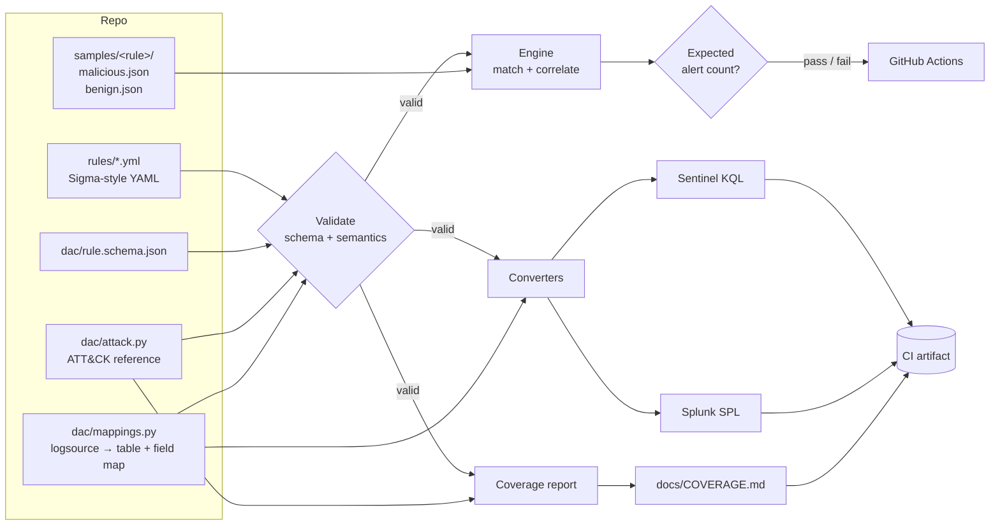

# Detection-as-Code

Sigma-style detection rules mapped to MITRE ATT&CK, with a small Python toolkit that:

1. **Validates** every rule against a JSON Schema plus semantic checks.
2. **Converts** rules to **Microsoft Sentinel KQL** and **Splunk SPL**.
3. **Tests** every rule against labelled JSON log samples: it must fire on the attack samples and stay quiet on the benign ones.
4. **Reports** ATT&CK coverage as a Markdown matrix.

CI runs all of this on every push, so a rule change that breaks detection or starts firing on benign data fails the build.

> This is a personal portfolio / learning project. The rules are written to be realistic, and the sample logs are synthetic, modelled on real Sysmon, Windows Security, CloudTrail and Entra ID sign-in events. It has not been deployed against a production SIEM. Treat the generated queries as a starting point to review and tune, not drop-in content.

## Contents

- [Architecture](#architecture)
- [Quick start](#quick-start)
- [Repository layout](#repository-layout)
- [Rule format](#rule-format)
- [Adding a rule](#adding-a-rule)
- [Included rules](#included-rules)
- [CI pipeline](#ci-pipeline)
- [Design decisions](#design-decisions)
- [Limitations](#limitations)

## Architecture



## Quick start

Requires Python 3.10+.

```bash
make install        # pip install -r requirements.txt
make validate       # schema + semantic validation
make test           # pytest: engine unit tests + every rule vs its samples
make test-samples   # human-readable table of rule results
make convert        # write KQL + SPL to build/kql and build/spl
make coverage       # regenerate docs/COVERAGE.md
make ci             # everything CI runs
```

Or call the CLI directly:

```bash
python -m dac validate
python -m dac test
python -m dac convert --target kql --out -     # print to stdout
python -m dac coverage --out -
```

Example output of `python -m dac test`:

```
rule                                               dataset    expected actual  result
aws_cloudtrail_logging_disabled                    malicious         2      2  PASS
aws_cloudtrail_logging_disabled                    benign            0      0  PASS
...
win_security_bruteforce_then_success               malicious         1      1  PASS
win_security_bruteforce_then_success               benign            0      0  PASS
```

## Microsoft Defender XDR custom detection rules

`python -m dac defender` packages each endpoint/identity/email rule as a **Defender XDR custom detection rule** (advanced hunting): the KQL query, run frequency, severity, MITRE techniques, impacted-asset entities, and an alert template, ready for the Defender XDR custom detection API or portal import. Rules whose source is SIEM-only (e.g. AWS CloudTrail) are skipped and listed.

```bash
python -m dac defender --out build/defender/custom-detections.json
```

## Microsoft Sentinel deployment and SIEM migration

**Deploy as Sentinel analytics rules.** `python -m dac sentinel` packages every rule as a scheduled analytics rule in one ARM template, ready for `az deployment group create`:

- KQL query, severity, and schedule (`queryFrequency`/`queryPeriod` from the rule's correlation window)
- MITRE ATT&CK tactics and techniques in Sentinel's format
- Entity mappings (Host, Account, IP, Process) for incidents, the investigation graph, and UEBA. Only columns that still exist after a `summarize` are mapped, so the deployment does not fail on missing columns
- Incident creation and alert grouping, with a stable GUID per rule so redeploys update rules instead of duplicating them

```bash
python -m dac sentinel --out build/sentinel/analytics-rules.json
az deployment group create -g <resource-group> --template-file build/sentinel/analytics-rules.json \
  --parameters workspace=<workspace-name>
```

**Plan a legacy SIEM migration.** `python -m dac migrate --legacy searches.csv` takes an export of legacy saved searches (name, sourcetype, ATT&CK techniques) and reports:

- which detections are already covered by a tested rule here (migrated / partial / gap / needs ATT&CK mapping)
- which data sources must be onboarded first and how: built-in connector, AMA with a DCR, CEF/Syslog through a Linux log forwarder, or a custom table with a parser

```
8 legacy detections; 50.0% already covered by tested rules.
| pan:threat | CommonSecurityLog | CEF via AMA on a Linux log forwarder | 1 |
| okta:im2   | Okta_CL           | Okta SSO connector (custom table + parser) | 1 |
```

## Repository layout

```
dac/
  engine.py          field matching, condition parser, correlation (sliding windows)
  rules.py           YAML loading, JSON Schema + semantic validation
  rule.schema.json   rule schema
  convert.py         KQL and SPL backends
  mappings.py        logsource -> backend table / search and field renames
  attack.py          ATT&CK technique/tactic reference (subset used here)
  harness.py         runs each rule against its sample datasets
  coverage.py        ATT&CK coverage markdown
  cli.py             `python -m dac ...`
rules/               detection rules, grouped by platform
samples/<rule>/      malicious.json + benign.json per rule
tests/               pytest suite
docs/COVERAGE.md     generated ATT&CK coverage report
docs/INTERVIEW_WALKTHROUGH.md
.github/workflows/ci.yml
```

## Rule format

Rules follow the shape of [Sigma](https://github.com/SigmaHQ/sigma) so they read familiarly, with a deliberately smaller feature set.

```yaml
title: Certutil Used To Download Or Decode Files
id: 4e9a1c7b-3f6d-4b28-9c51-b8e2d4a6f010     # UUID, unique across the repo
status: test                                  # experimental | test | stable | deprecated
description: >-
  Detects certutil.exe with -urlcache / -verifyctl or -decode ...
author: Dinesh Melimi
date: 2026-10-06
references:
  - https://attack.mitre.org/techniques/T1105/
tags:                                         # at least one tactic + one technique
  - attack.command-and-control
  - attack.t1105
logsource:                                    # selects the KQL table / SPL search
  product: windows
  category: process_creation
detection:
  selection_img:
    Image|endswith: '\certutil.exe'
  selection_cli:
    CommandLine|contains:                     # a list means OR
      - '-urlcache'
      - '-decode'
  condition: selection_img and selection_cli
falsepositives:
  - Administrators testing CRL retrieval
level: high
```

**Selections.** A selection is a map of `field|modifiers: value(s)`. All fields in a map must match (AND). A list of values matches if any value matches (OR). A selection can also be a list of maps (OR of maps). `Field: null` means the field is absent.

**Modifiers.** `contains`, `startswith`, `endswith`, `re` (regex), and `all` (turns a value list into AND). Without a modifier the comparison is case-insensitive equality. Dotted field names (`userIdentity.type`) reach into nested JSON.

**Condition.** Selection names combined with `and`, `or`, `not` and parentheses. `and` binds tighter than `or`.

**Correlation (optional).** Applied to events that matched the condition:

| type | meaning | required keys |
|---|---|---|
| `event_count` | ≥ `threshold` events per group within `timeframe` | `threshold` |
| `value_count` | ≥ `threshold` distinct values of `field` per group within `timeframe` | `field`, `threshold` |
| `sequence` | ≥ `min_count` events of step 1, then a step 2 event, within `timeframe` | `steps` (exactly 2) |

```yaml
correlation:
  type: sequence
  group_by: [TargetUserName]
  timeframe: 10m
  steps:
    - selection: selection_failed
      min_count: 5
    - selection: selection_success
```

## Adding a rule

1. Create `rules/<platform>/<name>.yml`. Generate an ID with `python -c "import uuid; print(uuid.uuid4())"`.
2. Tag it with an ATT&CK tactic and technique. If the technique is new to the repo, add it to `dac/attack.py` (validation rejects unknown IDs on purpose).
3. If it uses a new log source, add a KQL and SPL mapping in `dac/mappings.py`.
4. Add `samples/<name>/malicious.json` and `samples/<name>/benign.json`:
   ```json
   {
     "description": "What this dataset represents",
     "expected_alerts": 1,
     "events": [{"@timestamp": "2026-09-14T10:00:00Z", "...": "..."}]
   }
   ```
   Benign samples should contain *near misses* (same process, different arguments; same event ID, different group), not unrelated noise. That is what proves the rule is specific.
5. Run `make ci`. Commit the regenerated `docs/COVERAGE.md` (a test fails if it is stale).

## Included rules

| Rule | ATT&CK | Source | Logic |
|---|---|---|---|
| PowerShell encoded command | T1059.001, T1027 | Sysmon 1 | regex on `-enc`-style flag + Base64 |
| LSASS memory access | T1003.001 | Sysmon 10 | access mask list, minus known system callers |
| User added to local Administrators | T1098, T1136.001 | Security 4732 | group SID S-1-5-32-544 |
| Suspicious scheduled task | T1053.005 | Sysmon 1 | `schtasks /create /tr` + user-writable path or LOLBin |
| Brute force then success | T1110.001 | Security 4625/4624 | `sequence`: 5 failures then success in 10 min |
| AWS root console login | T1078.004 | CloudTrail | `ConsoleLogin` by `Root` |
| CloudTrail logging disabled | T1562.008 | CloudTrail | `StopLogging` / `DeleteTrail` |
| Impossible travel (lite) | T1078, T1078.004 | Entra ID sign-ins | `value_count`: 2+ countries in 1 h |
| Office spawning shell | T1566.001, T1204.002, T1059.003 | Sysmon 1 | Office parent, shell/LOLBin child |
| Certutil download / decode | T1105, T1140 | Sysmon 1 | `-urlcache`, `-verifyctl`, `-decode` |

See [docs/COVERAGE.md](docs/COVERAGE.md) for the full matrix, including tactics with no coverage yet.

## CI pipeline

`.github/workflows/ci.yml`:

1. **lint** - `ruff check`.
2. **validate** - `python -m dac validate` (schema + semantics + unique IDs + samples exist).
3. **test** - `pytest` on Python 3.10 and 3.12, then writes the per-rule results table to the job summary.
4. **artifacts** - converts every rule to KQL and SPL, generates the coverage report, and uploads `build/` as a workflow artifact.

## Design decisions

- **Sigma-like, not full Sigma.** Using real Sigma + pySigma would be the production choice. Writing a small engine here was intentional: it shows how rule matching, condition parsing and backend conversion actually work, and keeps the whole thing readable in an afternoon. The rule format stays close enough to Sigma that migrating would be mostly mechanical.
- **Two validation layers.** JSON Schema catches structure (required metadata, enums, UUID format). Semantic checks catch what schema can't: a condition referencing an undefined selection, an unused selection, a bad regex, an unknown ATT&CK ID, a tactic that doesn't belong to any tagged technique, a log source with no backend mapping.
- **Tests are data, not code.** Each rule ships with labelled malicious and benign datasets and an *exact* expected alert count. Exact counts catch both missed detections and over-firing (e.g. a correlation rule that suddenly alerts per event).
- **One evaluator, two backends.** The Python engine is the reference implementation. KQL and SPL backends share one traversal of the condition AST and only implement operators, literals and the aggregation tail. Adding a backend means implementing ~8 small methods.
- **Field mapping lives outside rules.** Rules use Sysmon/CloudTrail-native field names; `mappings.py` renames them per backend (e.g. `Image` → `FolderPath` for `DeviceProcessEvents`). Rules stay portable.
- **Case-insensitive by default.** Windows paths and command lines are case-insensitive, so the engine, KQL (`=~`, `contains`) and SPL (`lower()`, `(?i)`) all match that way.
- **Deterministic coverage report.** No timestamps, sorted output, and a test that fails if the committed report is stale.

## Limitations

- Converted queries are **not executed** against Sentinel or Splunk in CI; tests assert their structure. Field mappings are reasonable defaults and must be checked against your connectors, TAs and parsers.
- The engine uses **sliding** windows; generated KQL/SPL use `bin()` **tumbling** windows, so a burst that straddles a bin boundary can be missed by the SIEM query.
- Correlation emits at most one alert per group per run, and `sequence` supports exactly two steps.
- SPL `like()` treats `_` as a wildcard; the backend does not escape it.
- Not supported from Sigma: `1 of selection_*` / `all of`, `|base64offset`, `|cidr`, `|windash`, placeholders.
- The ATT&CK table in `dac/attack.py` is a hand-maintained subset, not the full STIX dataset.
- "Impossible travel (lite)" only compares country codes; it does not compute distance or speed.

## License

MIT - see [LICENSE](LICENSE).
